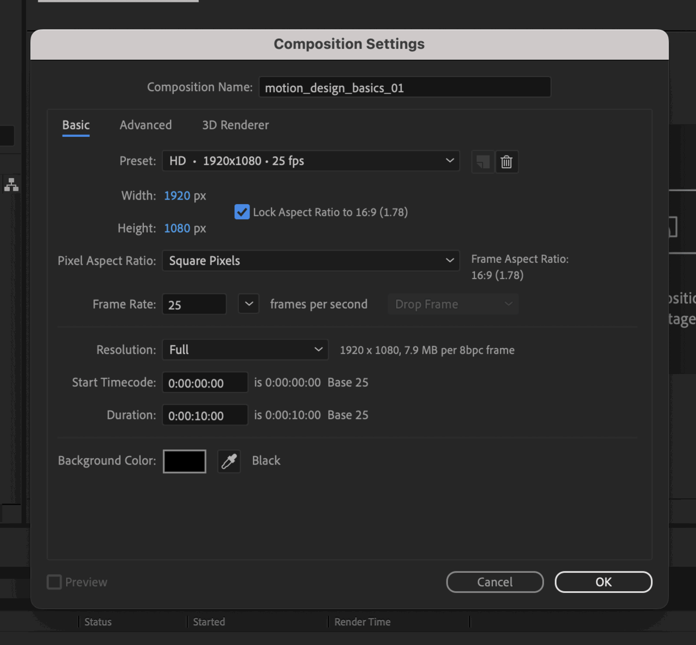

Learning new software is a hunt for hidden buttons. Let's find them and set things up right from the start.

## The Workspace

We want everyone's workspace to look the same, so we reset it to Default. Do this any time your panels end up in strange places.

:::step Reset your workspace
Windows all over the place? Follow this path.
`Window > Workspace > Default`
`⇧F10 / Shift+F10`
:::

We have different panels for different things:

1. **Toolbar** – on top. Create shape and text layers, move objects and adjust anchor points.
2. **Project** – on the left. Import your files and manage your project's structure.
3. **Effect Controls** – a tab behind the Project panel. The settings of the effects on your selected layer.
4. **Composition** – in the centre. This is where you preview your animation.
5. **Effects & Presets** – on the right, stacked with other panels. Find your effects here.
6. **Timeline** – at the bottom. This is where you'll spend most of your time: arranging, cutting and animating.

:::demo ae-panels
Schematic of the Default workspace. The six panels light up one after another: Toolbar, Project, Effect Controls, Composition, Effects & Presets, Timeline.
:::

:::tip
Can't find a panel? Calm, they're all in the Window menu.
`Window`
:::

## Structure

A clean structure helps you find your files fast and update projects later. After Effects links files instead of embedding them: the project only stores where your files are.

```tree On disk
motion_design/
  aep/
  footage/
    ai/
    psd/
  output/
```

```tree In the Project panel
comps/
  maincomps/
  precomps/
footage/
  ai/
  audio/
  mov/
  psd/
  Solids/
```

:::step Build it on disk
Create the folder structure on your disk before you save. If everything stays inside it, you can move the whole folder later.
:::

:::step Create folders
In the Project panel, right-click and choose New Folder.
:::

:::step Sort into categories
Two main folders: comps and footage. Comps split into maincomps and precomps, footage gets one folder per file type.
:::

:::step Save into aep
Save your project into the aep folder.
`⌘⇧S / Ctrl+Shift+S`
:::

:::step Date the filename
Save manually every day with the date in front of the name.
`20240409_projectname`
:::

:::tip
Auto-Save is safe, saving yourself is safer. Check it's on and set the interval (Windows: Edit > Preferences).
`After Effects > Settings > Auto-Save`
:::

## Film Formats + Compositions

After Effects measures in pixels, because we make video. We work in RGB at 25 frames per second. A composition is your film: it holds the layers and has its own timeline.

:::step New composition
Use the menu, or right-click in the empty Project panel.
`Composition > New Composition`
:::

:::step Name it
Use a descriptive name, no spaces.
`motion_design_basics_01`
:::

:::step Set the preset
Leave Square Pixels and set Duration to 10 seconds.
`HD · 1920×1080 · 25 fps`

:::

:::step Open and file it
Double-click the comp (filmstrip icon) to open it in the Timeline. Move it into your comps folder.
:::

:::warning
16:9 doesn't cover everything: social media, screens and banners all need their own formats. Clarify them before you start, changing a finished project is long.
:::

:::demo format-frames
Four formats at the same height: 16:9, 9:16, 1:1 and 4:5. The same circle moves across each one.
:::

:::exercise Set up your first project
starter: downloads/aep_structure.zip
result: tree

1. Reset your workspace to Default.
2. Unzip the folder template on your disk.
3. Rename `aep_structure` to your project name, for example `motion_design`.
4. In the Project panel, create `comps` (with `maincomps` and `precomps`) and `footage` (with `ai` and `psd`).
5. Create a comp `motion_design_basics_01`: HD 1920×1080, 25 fps, 10 seconds.
6. Move the comp into `comps > maincomps`.
7. Save the project into the `aep` folder as `YYYYMMDD_projectname`.
8. Check that Auto-Save is on.

```tree Your Project panel
comps/
  maincomps/
    motion_design_basics_01
  precomps/
footage/
  ai/
  psd/
```
:::

:::shortcuts
| Action | Mac | Windows |
|---|---|---|
| New Composition | `⌘N` | `Ctrl+N` |
| Composition Settings | `⌘K` | `Ctrl+K` |
| Save As | `⌘⇧S` | `Ctrl+Shift+S` |
| Default workspace | `⇧F10` | `Shift+F10` |
:::

:::more
- [Workspaces, panels and viewers](https://helpx.adobe.com/after-effects/desktop/get-started/get-familiar-with-the-interface/workspaces-panels-viewers.html) – Adobe After Effects Help
- [Composition basics](https://helpx.adobe.com/after-effects/desktop/work-with-compositions/composition-settings/composition-basics.html) – Adobe After Effects Help
- [Social media video specs](https://sproutsocial.com/insights/social-media-video-specs-guide/) – Sprout Social
:::
