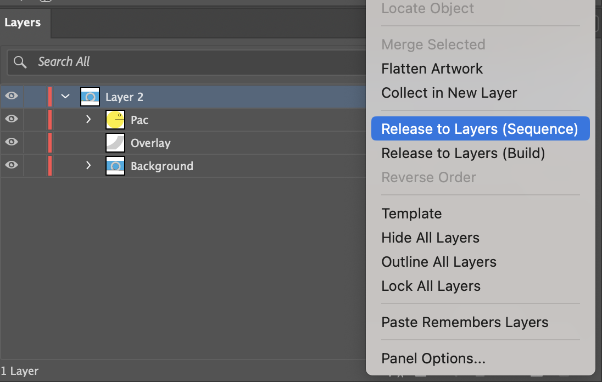
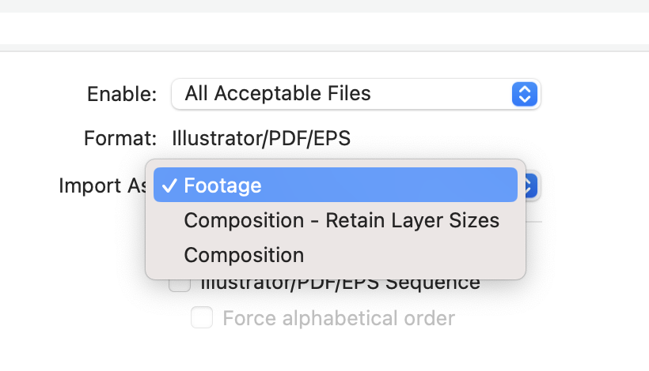
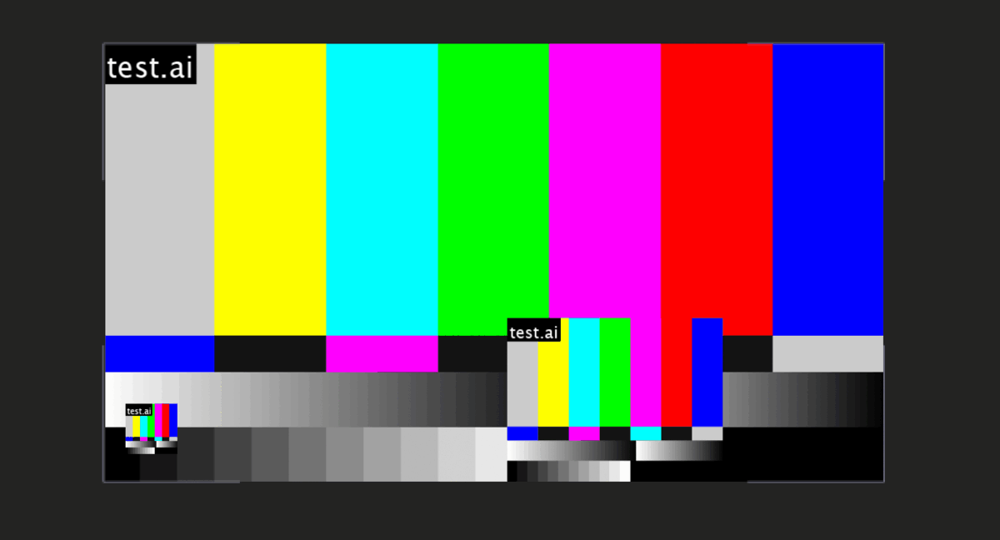

To start animating, we need things to work with. Import them right and every layer stays editable.

## Import Files

After Effects handles many formats. These are the ones you need:

- **.ai** – illustrations with layers
- **.psd** – image compositions with layers, e.g. `loop.psd` in the starter folder
- **.jpg .png .tif** – images
- **.wav .mp3** – audio
- **.mov** – video

:::step Import a file
Double-click the empty Project panel, or right-click and choose Import > File.
`⌘I / Ctrl+I`
:::

## Illustrator Files

Every element you want to animate needs its own layer. Prepare the file in Illustrator first. Footage merges everything visible into one flat file, Composition keeps every layer editable.

:::step Release to layers
In the Layers panel, select the top layer. Choose Release to Layers (Sequence) from the panel menu.

:::

:::step Clean up
Rename the layers and drag them out of the group. Delete the empty group and save.
:::

:::step Import as composition
With Retain Layer Sizes, each anchor point sits in the middle of its object. With plain Composition, it sits in the middle of the screen.
`Composition – Retain Layer Sizes`

:::

:::step File it
Move the new layers folder into footage > ai and the comp into comps.
:::

:::demo import-anchors
The same three shapes rotate in two comps. Imported as Composition, they turn around the middle of the comp. Imported with Retain Layer Sizes, each turns around itself.
:::

:::tip
Only need one layer? Import as Footage and pick it under Choose Layer.
:::

## Relink

If a file moves out of its folder, After Effects can't find it. You get a warning and colour bars instead of your file.



:::step Move it back
Put the file back where it was. Right-click it in the Project panel and reload.
`Reload Footage`
:::

:::step Or replace it
Right-click the first missing file and point After Effects to its new place.
`Replace Footage > File`
:::

:::warning
Moved files outside the structure? Peak. Keep everything inside your project folder and this never happens.
:::

## Collect Files

Handing in a project or moving to another computer? Collect Files copies the project and every file it uses into one new folder.

:::step Collect
Save first, then choose Collect Source Files: All and pick an empty folder.
`File > Dependencies > Collect Files`
:::

:::step Check the folder
Open the new folder: the project, all footage and a short report. Hand in this folder, not your working one.
:::

:::exercise Import a layered file
starter: continue 01
result: tree

1. Open `loop.ai` from your `footage > ai` folder in Illustrator and release the top layer to layers.
2. Rename the layers `ball`, `loop` and `bg`, drag them out of the group, delete the empty group and save.
3. In After Effects, import the file as `Composition – Retain Layer Sizes`.
4. Move the layers folder into `footage > ai` and the comp into `comps`.
5. Open the comp and check that the layers sit in the right place.

```tree Your Project panel
comps/
  loop
footage/
  ai/
    loop Layers/
      ball/loop.ai
      bg/loop.ai
      loop/loop.ai
```
:::

:::shortcuts
| Action | Mac | Windows |
|---|---|---|
| Import File | `⌘I` | `Ctrl+I` |
| Import Multiple Files | `⌥⌘I` | `Ctrl+Alt+I` |
:::

:::more
- [Importing and interpreting footage](https://helpx.adobe.com/after-effects/desktop/work-with-footage-items/import-and-interpret-footage-items/importing-interpreting-footage-items.html) – Adobe After Effects Help
- [Working with footage items](https://helpx.adobe.com/after-effects/desktop/work-with-footage-items/manage-footage-items/footage-items.html) – Adobe After Effects Help
:::
