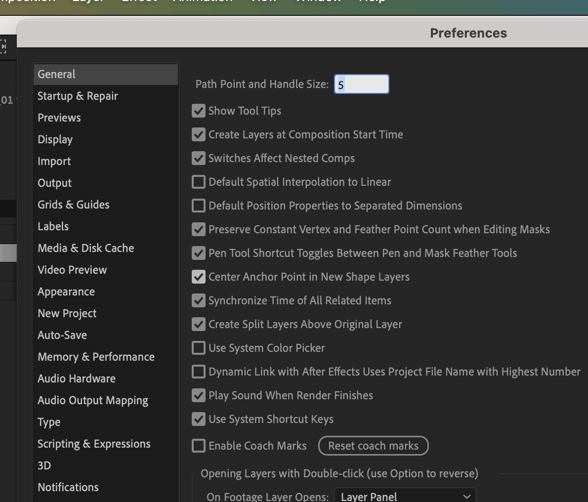
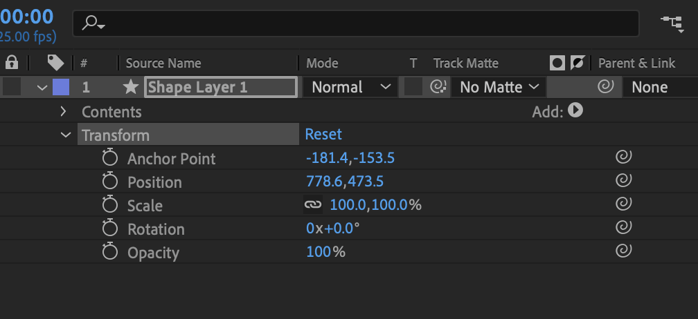
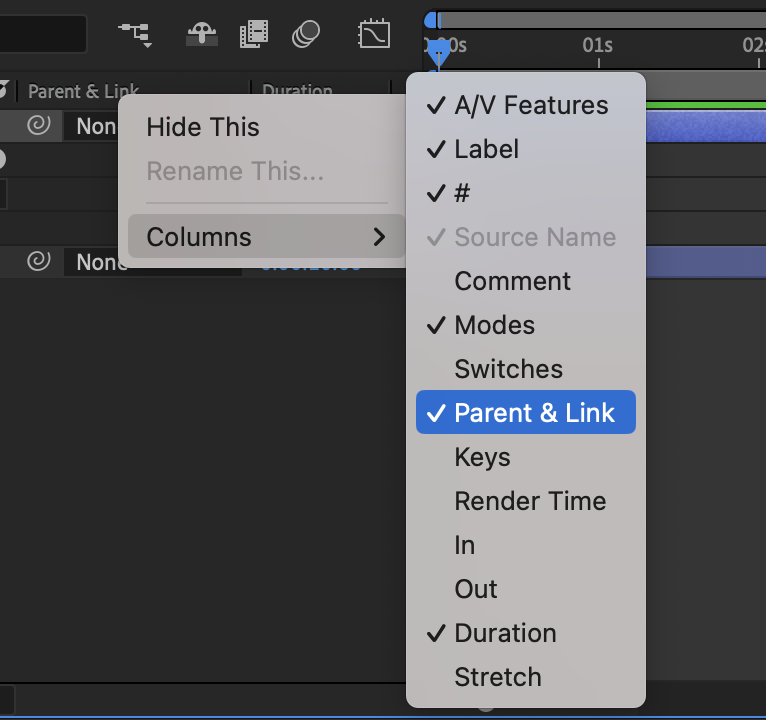
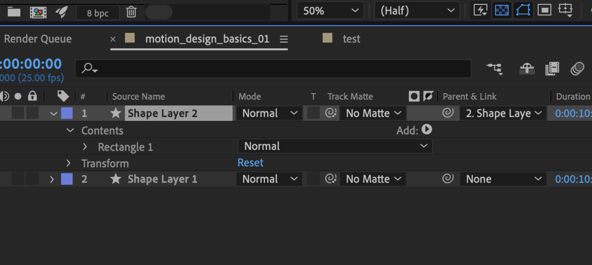

Everything in After Effects is a layer. We start with the simplest ones: shapes.

## Shape Layers

Before you draw, change one setting so the anchor point lands in the centre of every new shape.

:::step Center the anchor point
Turn on Center Anchor Point in New Shape Layers. Older Mac versions say Preferences instead of Settings, on Windows it's Edit > Preferences > General.
`After Effects > Settings > General`

:::

:::step Pick a shape tool
Select the Ellipse tool in the Toolbar. Press Q to cycle through the shapes.
`Q`
:::

:::step Draw
Drag in the Composition panel. Hold Shift for a perfect circle, hold Space to move it while drawing.
:::

:::step One shape per layer
Deselect everything before you draw the next shape. Otherwise it lands inside the selected layer.
`F2`
:::

:::tip
Double-click the tool icon and the shape fills the whole comp. Allow it.
:::

A shape layer can hold several shapes in its Contents. They share one Transform, so they always move together. That's a workflow for later: for now, one shape per layer.

```tree Now: one shape per layer
Shape Layer 2/
  Contents/
    Rectangle 1/
  Transform/
Shape Layer 1/
  Contents/
    Ellipse 1/
  Transform/
```

```tree Later: several shapes in one layer
Shape Layer 1/
  Contents/
    Rectangle 1/
    Ellipse 1/
  Transform/
```

:::tip
Anchor point still not in the centre? Fix it on the layer, or reset your preferences.
`Layer > Transform > Center Anchor Point in Layer Content`
:::

## Properties

Open the layer with the arrow: you find Contents and Transform. Transform holds the properties you animate: Anchor Point, Position, Scale, Rotation and Opacity.

:::step Change the values
Drag the blue values, or move the shape with the Selection tool. Watch the values change.

:::

:::step Reset
Click Reset next to Transform to go back to the start values.
:::

## Parenting

Parenting links layers: the child follows everything the parent does.

:::step Show the column
If Parent & Link is hidden, right-click a column header.
`Columns > Parent & Link`

:::

:::step Pick the parent
In the child's Parent & Link menu, choose the parent layer. Or drag the pick whip onto it.

:::

:::step Control with a null
A null is an invisible layer that only exists to be a parent. Parent your shapes to it and animate the null.
`Layer > New > Null Object`
:::

## Precompose

Precompose bundles layers into their own comp, a precomp. Use it to reuse an element or to keep the Timeline clean.

:::step Precompose layers
Select the layers and choose Move all attributes into the new composition.
`Layer > Pre-compose`
:::

:::step File it
The precomp shows up in the Project panel. Move it into comps > precomps.
:::

:::exercise A square that follows a circle
starter: continue 01
result: demo:parenting

1. Open `motion_design_basics_01`.
2. Turn on Center Anchor Point in New Shape Layers.
3. Draw a circle.
4. Change its Position, Scale, Rotation and Opacity, then click Reset.
5. Press F2 to deselect, then draw a small square. It gets its own layer.
6. Set the circle as the square's parent.
7. Move, scale and rotate the circle. The square follows.
8. Rename the comp `motion_design_basics_01_parenting`.
:::

:::shortcuts
| Action | Mac | Windows |
|---|---|---|
| Cycle shape tools | `Q` | `Q` |
| Deselect all | `F2` | `F2` |
| Center Anchor Point in Layer Content | `⌥⌘Home` | `Ctrl+Alt+Home` |
| Position / Scale / Rotation | `P` / `S` / `R` | `P` / `S` / `R` |
| Opacity / Anchor Point | `T` / `A` | `T` / `A` |
| Rename layer or comp | `Return` | `Enter` |
| Pre-compose | `⌘⇧C` | `Ctrl+Shift+C` |
:::

:::more
- [Creating shapes](https://helpx.adobe.com/after-effects/desktop/drawing-painting-and-paths/shapes-and-shape-attributes/creating-shapes-masks.html) – Adobe After Effects Help
- [Layer properties](https://helpx.adobe.com/after-effects/desktop/work-with-layers/layer-properties/layer-properties.html) – Adobe After Effects Help
:::
