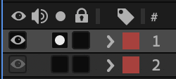
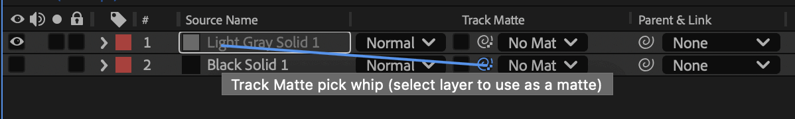

Four ways to show and hide parts of a shape. Same ting, different tools.

## Masks

A mask cuts out part of a layer. You draw it directly on the selected layer.

:::step Select the layer
Select the layer first. Otherwise you draw a new shape layer instead of a mask.
:::

:::step Draw the mask
Draw with the Pen tool or a shape tool on the selected layer.
`G`
:::

:::step Check it
Turn on the Solo switch to see only this layer.

:::

## Track Mattes

A track matte uses another layer as the mask. The matte layer defines what's visible.

:::step Pick the matte
In the Track Matte column of your layer, choose the matte from the menu or drag the pick whip onto it.

:::

:::step Alpha or Luma
Alpha uses the shape of the matte, Luma uses its brightness. Invert flips it.
:::

## Linear Wipe

Linear Wipe is an effect that wipes a layer away in a straight line.

:::step Apply the effect
Search for Linear Wipe in the Effects & Presets panel and drag it onto your layer.
:::

:::step Animate it
Animate Transition Completion from 0% to 100%.
:::

## Trim Paths

Trim Paths draws and erases the stroke of a shape. Start and End set the length, Offset sets which part is shown.

:::step Add Trim Paths
Open the layer's Contents and add Trim Paths.
`Add > Trim Paths`
:::

:::step Animate it
Animate End from 0% to 100%. Then try Start and Offset.

:::

:::tip
Trim Paths only works on a stroke. No stroke, no line.
:::

:::exercise One circle, four techniques
starter: none
result: demo:masking-set

1. Create a comp `motion_design_basics_06_masking` and draw a filled circle.
2. Duplicate it three times and place the four circles side by side.
3. Circle 1: draw a mask that cuts it in half.
4. Circle 2: draw a square above it, use it as Alpha Matte and animate the square across the circle.
5. Circle 3: apply Linear Wipe and animate Transition Completion.
6. Circle 4: turn the fill off and the stroke on, add Trim Paths and animate End.
7. Preview and compare.
:::

:::shortcuts
| Action | Mac | Windows |
|---|---|---|
| Pen tool | `G` | `G` |
| Show Mask Path | `M` | `M` |
:::

:::more
- [Create masks](https://helpx.adobe.com/after-effects/desktop/drawing-painting-and-paths/work-with-masks/create-masks.html) – Adobe After Effects Help
- [Track Mattes and Traveling Mattes](https://helpx.adobe.com/after-effects/desktop/work-with-transparency-and-compositing/work-with-track-mattes-and-traveling-mattes/track-mattes-and-traveling-mattes.html) – Adobe After Effects Help
- [Shape attributes and path operations](https://helpx.adobe.com/after-effects/desktop/drawing-painting-and-paths/shapes-and-shape-attributes/shape-attributes-paint-operations-path.html) – Adobe After Effects Help
:::
