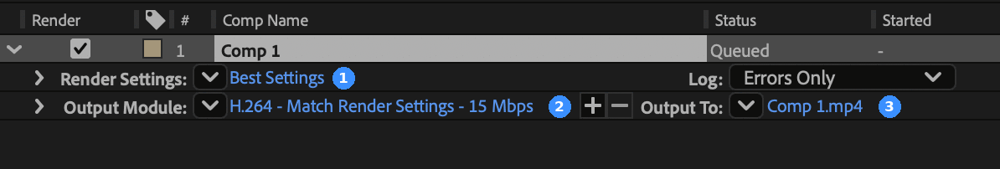
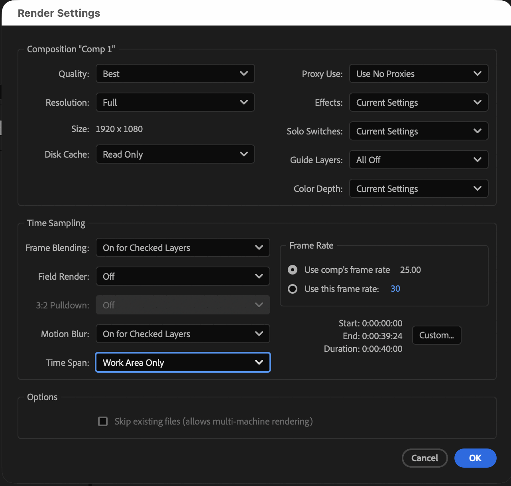

To play your animation outside After Effects, you render it. Right settings, no surprises. And watch it before you send it, trust.

## Render Queue

Select one or more comps and add them to the Render Queue. Three things matter: Render Settings, Output Module and Output To. Then hit Render.



:::step Trim first
Set the work area with B and N. Right-click it and trim the comp, so you know the exact length later.
`Trim Comp to Work Area`
:::

:::step Add to the queue
Select the comp and add it to the Render Queue.
`Composition > Add to Render Queue`
:::

:::step Render Settings
Leave Best Settings. Set Time Span to Work Area Only.

:::

:::step Output Module
Choose the format for where your movie goes next. See the table below.
:::

:::step Output To
Save into your output folder.
:::

:::step Render and check
Click Render. Then watch the whole movie and check that everything is right.
:::

## Formats

Pick the format by where the movie goes next.

| Use | Format |
|---|---|
| Web, mobile, desktop | H.264 · 15 Mbit/s |
| Editing program | .mov · Apple ProRes 422 · RGB |
| Editing with transparency | .mov · Apple ProRes 4444 · RGB + Alpha |
| Single frames for editing | TIFF sequence · RGB + Alpha |

:::demo alpha
The same render over other footage. RGB: the black background covers it. RGB + Alpha: only the shape covers it.
:::

:::tip
Image sequences have one big advantage: a broken frame can be re-rendered alone.
:::

:::exercise Render for the web and for editing
starter: continue 03
result: tree

1. Open `motion_design_basics_01_parenting`.
2. Set the work area and trim the comp to it.
3. Add the comp to the Render Queue.
4. Render it as H.264 into your `output` folder.
5. Render it again as ProRes 4444 with RGB + Alpha.
6. Watch both movies.

```tree Your output folder
output/
  motion_design_basics_01_parenting.mp4
  motion_design_basics_01_parenting.mov
```
:::

:::shortcuts
| Action | Mac | Windows |
|---|---|---|
| Add to Render Queue | `⌃⌘M` | `Ctrl+M` |
| Work area start / end | `B` / `N` | `B` / `N` |
:::

:::more
- [Basics of rendering and exporting](https://helpx.adobe.com/after-effects/desktop/render-and-export/basics-of-rendering-and-exporting/basics-rendering-exporting.html) – Adobe After Effects Help
- [Exporting H.264 from the Render Queue](https://helpx.adobe.com/after-effects/desktop/render-and-export/export-h-264-from-the-after-effects/exporting-h264-from-the-after-effects-render-queue.html) – Adobe After Effects Help
- [Rendern / Komprimieren](https://dasnorm.ch/AE/einfuehrung/rendern_komprimieren/) – dasnorm.ch, also how to make files smaller with HandBrake
:::
